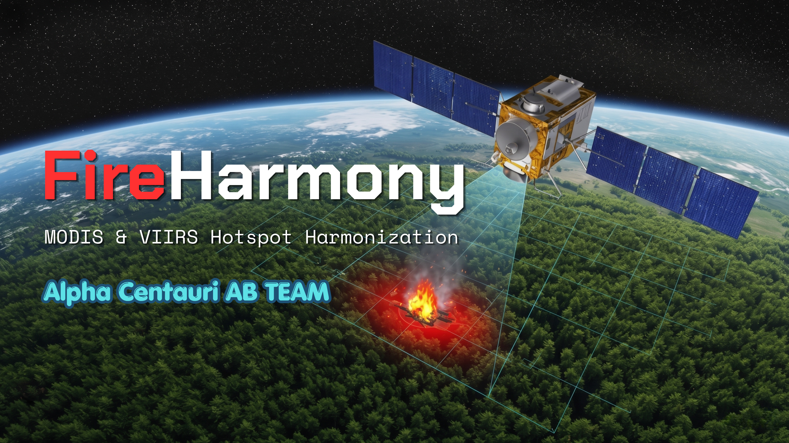
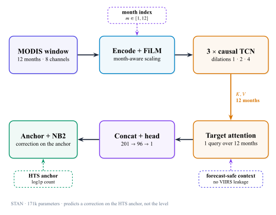
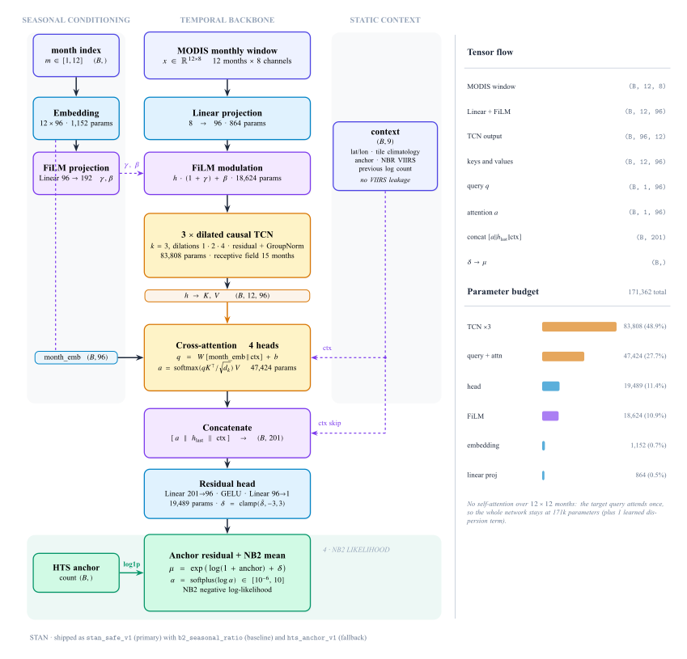

# FireHarmony

**Satellite fire intelligence lab for harmonizing NASA FIRMS MODIS and VIIRS hotspot detections.**
NASA Space Apps 2026: Harmonization of MODIS and VIIRS Hot Spots.

MODIS (Terra/Aqua, 1 km, since 2000) and VIIRS (Suomi-NPP/NOAA-20/21, 375 m, since 2012) have different detection sensitivity: VIIRS detects roughly 3-5x more hotspots, especially small agricultural burns. Summing raw counts across eras creates an artificial ~4x jump in 2012. FireHarmony builds a single **hotspot-detection activity index** on a daily `0.05°` grid so MODIS-era and VIIRS-era records can be compared on a common, uncertainty-aware scale.

> **Units:** hotspot detections / sensor-adjusted activity index, **not** burned area, fire intensity, or emissions. The 2012 VIIRS-era break, QA/coverage gaps, and present-time data lags are surfaced explicitly across the UI and exports.

---

## Core Capabilities

| Layer | Capability | Details |
|---|---|---|
| **Ingest & QA** | Strict validation & deduplication | Rejects unknown instruments, invalid `HHMM`, and platform/date anachronisms without silent repair; deduplicates overlapping raw pulls. |
| **Harmonization** | Empirical & ML calibration | Monthly calibration `k = MODIS / VIIRS`. VIIRS stays authoritative where observed; MODIS-only cells are upscaled by `1/k` and tagged `estimated` with uncertainty intervals. |
| **Served Models** | Strictly 3 supported methods | `stan_safe_v1` (primary, recommended), `b2_seasonal_ratio` (baseline), `hts_anchor_v1` (fallback). |
| **Visual Analytics** | Interactive React SPA | Calendar (month x year matrix + MAD z-scores), Sensor Lab, Evidence X-Ray, Data Methods, and grounded AI Investigator with interactive Driver.js onboarding tours. |



*STAN overview (compact): MODIS 12-month window -> Encode + FiLM -> 3x causal TCN -> target attention -> concat + head -> residual correction on the HTS anchor (NB2).*

---

## Quick Start

**Prerequisites:** Python 3.11 (`.python-version`), Node.js. For real NASA pulls, obtain a [NASA FIRMS map key](https://firms.modaps.eosdis.nasa.gov/api/area/). Always use `make` or `.venv/bin/python` (system `python3` may lack project dependencies).

```bash
# 1. Create virtual environment & install dependencies
python3.11 -m venv .venv
make install-dev        # serving + tests + dataframes, no torch (fast)

# 2. Configure environment (optional for real FIRMS pulls)
cp backend/.env.example backend/.env
# set FIRMS_MAP_KEY=<your_key> in backend/.env

# 3. Start development servers
make dev                # FastAPI http://127.0.0.1:8000 + Vite http://127.0.0.1:5173
```

**Production-style serving (built SPA served by FastAPI):**

```bash
cd frontend && npm ci && npm run build && cd ..
pm2 start ecosystem.config.cjs   # serves on http://127.0.0.1:8000
```

**Offline / demo datasets:**
- `make sample` generates a deterministic synthetic dataset for fast local testing.
- A checksum-pinned 24-month Vietnam demo pack is included under `backend/data/firms/demo_pack/` (`make demo-verify` / `make demo-install`) for real-data demonstrations without a full NASA archive pull.

---

## Data Pipeline & Latency

Real FIRMS pulls are stored under `backend/data/firms/raw/` and are **gitignored**.

```bash
# Fetch or resume monthly chunks (idempotent, parallel; skips existing chunks)
.venv/bin/python -m backend.scripts.firms.fetch_full_month \
  --aoi vietnam --bbox 104,10,109,16 --start-year 2012 --end-year 2025 --workers 4

# Fill manifest-missing days only
.venv/bin/python -m backend.scripts.firms.fetch_missing \
  --aoi australia --start-year 2019 --end-year 2025
```

`fetch_full_month` stitches 5-day windows across every day of each month (including day 31 and leap years) and records requests in a ledger; `fetch_missing` downloads only missing intervals.

> **Sensor/platform availability note:** Historical archive pulls (`*_SP`) primarily contain Suomi-NPP VIIRS rows, while 2024+ NRT pulls (`backend/scripts/firms/fetch_firms.py`) also include `VIIRS_NOAA20_NRT` and `VIIRS_NOAA21_NRT`.

### Latency & Query Filters

| Path (full Vietnam pull) | Cold | Warm (disk cache) |
|---|---:|---:|
| `/api/firms/calendar?method=stat` | 153.7 s | 118 ms |
| `/api/firms/calendar?method=stan` | 215.3 s | 91 ms |
| `/api/firms/map-cells` | 94-171 ms | 85-91 ms |

Every response includes `X-Elapsed-Ms`. Warm caches with `make prewarm` (`AOI=... METHODS=...`).
Supported filters: `qa_min` (`all|nominal|high`), `platform_set` (`all|snpp`), `source_type` (`all|land|vegetation`), `from_date`/`to_date`, `bbox`, and GeoJSON `geometry` (point-in-polygon, `method=stat` only).

### Where STAN Runs vs Where `stat` Runs

| Mode / Scope | Active Method | Why |
|---|---|---|
| Preset AOIs (`vietnam`, `amazon`, `australia`), `data=raw`, unfiltered | **`stan_safe_v1`** (default) or `hts_anchor_v1` | Full 180-month AOI history and `1°` tile-month context are present on disk. |
| `aoi=custom` (live 14-day NASA FIRMS pull) | **`stat`** (`b2_seasonal_ratio` / empirical `k`) | Live pulls lack a 12-month tile window; `STAN`/`HTS` return `409` instead of extrapolating. |
| Filtered subsets (`bbox`, `geometry`, `from_date`/`to_date`, `qa_min`, `platform_set`, `source_type`) | **`stat`** | AOI-level `STAN`/`HTS` totals cannot be reallocated to arbitrary sub-polygons or filtered slices. |
| Offline synthetic demo (`data=sample`) | **`stat`** | Synthetic demo has no `1°` tile artifacts (`STAN`/`HTS` require `data=raw`). |

**Why STAN/HTS require full-AOI 12-month histories (and return `409` on custom/filtered slices):**
1. **12-month causal context (`T = 12`)**: STAN's causal TCN (`dilations 1, 2, 4`) and target-month attention consume 12 consecutive historical `1°` MODIS tile-months plus the multi-year HTS tile anchor; a 1-14 day live `custom` pull does not contain this sequence.
2. **AOI-level total conservation**: `stan_safe_v1` and `hts_anchor_v1` predict monthly totals at the full-AOI level. Splitting or scaling a full-AOI prediction down to an arbitrary `bbox`, `geometry`, or QA/platform subset without tile-level ground truth would invent counts.
3. **No unverified zero-shot transfer**: Leave-One-Region-Out (LOO) checks show STAN does not yet beat `hts_anchor_v1` on unseen regions outside the 3 evaluated AOIs (`vietnam`, `amazon`, `australia`), so custom regions use `method=stat` transparently instead of extrapolating.

---

## Models & Evaluation

<!-- BEGIN GENERATED README METRICS -->
_Generated from `evaluation_raw.json` (eval-v4); headline = full-month AOIs ['vietnam', 'amazon', 'australia'], n=72. Primary: `stan_safe_v1`._

| Method | MAE (headline) |
|---|---:|
| `b0_raw_modis` | 38119.8 |
| `b1_global_ratio` | 5555.2 |
| `b2_seasonal_ratio` | 4581.1 |
| `stan_safe_v1` | 4154.7 |
| `hts_anchor_v1` | 4524.8 |

`stan_safe_v1` − `b2_seasonal_ratio` ΔMAE -426.4, 95% CI [-1060.4, +216.3] — CI includes 0, so the gain is not established.
<!-- END GENERATED README METRICS -->

The point estimate favors STAN, while the 95% bootstrap confidence interval includes zero; statistical superiority over `b2_seasonal_ratio` is not yet established. Operational recommendation and statistical evidence are tracked separately. See [docs/FIRMS_MODEL_CARD.md](docs/FIRMS_MODEL_CARD.md) and [docs/TRUTH_CONTRACT.md](docs/TRUTH_CONTRACT.md).

### STAN Architecture (`stan_safe_v1`)



*171,362 parameters, NB2 count loss, residual on the HTS anchor. Three converging streams: (1) seasonal conditioning `month -> embedding -> FiLM`, (2) causal TCN backbone producing `K, V`, (3) forecast-safe static context forming the single target query (no same-month neighbour VIIRS). Right panels show tensor flow and parameter budget.*

- **Slide version (compact):** [docs/stan_architecture_slide.svg](docs/stan_architecture_slide.svg) ([PNG](docs/stan_architecture_slide.png))
- **Source / rebuild:** [docs/stan_architecture.tex](docs/stan_architecture.tex) (`docs/render_stan_figure.sh` via XeLaTeX + `pdftocairo`)
- **Details:** [docs/STAN_ARCHITECTURE.md](docs/STAN_ARCHITECTURE.md) | TorchView graph: [docs/stan_torchview.dot](docs/stan_torchview.dot)

---

## API Surface

| Endpoint | Description |
|---|---|
| `GET /api/firms/health` (`/api/health`) | `status`, `uptime_s`, torch/model availability, `methods_available` |
| `GET /api/firms/calendar` | Month x year activity index and anomaly signals |
| `GET /api/firms/map-cells` | Monthly `0.05°` gridded cells |
| `GET /api/firms/evaluation` | MAE/RMSE table, robustness, CI, primary-method verdict |
| `GET /api/firms/backtest` | Month-by-month raw-vs-actual series for a served method |
| `GET /api/firms/coverage-xray` | Per-AOI/year MODIS/VIIRS observation density and confidence labels |
| `POST /api/firms/investigate-stream` | Grounded SSE investigation stream backed by FIRMS data tools |
| `GET /api/firms/export` / `brief` | CSV export and one-page summary brief |

In production, FastAPI serves both `/api` and the built SPA on port 8000 under PM2 (`alphacentauriab`); Tailscale Funnel is the only public entry, and `GET /api/firms/health` is the health check. AI chat and CSV upload/ingest are protected by Cloudflare Turnstile (invisible, no cookie); maps/calendar/evidence stay free. See [docs/TURNSTILE.md](docs/TURNSTILE.md).

---

## Project Structure

```text
FireHarmony/
├─ backend/app/firms/        # ingest, schema, QA, dedup, harmonize, eval, STAN, HTS
├─ backend/scripts/firms/    # fetch, cache, prewarm, rebuild, evaluation
├─ backend/data/             # gitignored raw FIRMS pulls, manifests, caches, demo pack
├─ frontend/src/             # React app (Calendar, Evidence, Lab, Investigator, Methods)
├─ docs/                     # method, model/data cards, architecture, audit, submission
├─ Makefile                  # install, dev, test, fetch, prewarm
└─ ecosystem.config.cjs      # PM2 serving config
```

---

## Researcher Pipeline (Reproduce & Extend)

To reproduce all benchmarks, train STAN/HTS from scratch, or extend the pipeline to a new AOI (requires >= 12 consecutive paired MODIS + VIIRS months):

1. **Fetch & repair raw NASA FIRMS CSVs** (requires `FIRMS_MAP_KEY` in `backend/.env`):
   ```bash
   cd backend
   ../.venv/bin/python -m scripts.firms.fetch_full_month --aoi vietnam --bbox 104,10,109,16 --start-year 2012 --end-year 2026 --workers 4
   ../.venv/bin/python -m scripts.firms.fetch_missing --aoi vietnam --start-year 2012 --end-year 2026 --workers 4
   ```
2. **Verify manifest & QA integrity** (rejects anachronistic platforms, invalid `HHMM`, and Day-31 gaps):
   ```bash
   ../.venv/bin/python -m scripts.firms.download_and_verify --aoi vietnam
   ```
3. **Run the full 10-stage training & evaluation pipeline** (`build_tiles` -> `evaluate` -> `make_benchmark` -> `evaluate_hts` -> `build_hts_series` -> `stan` -> `build_stan_series` -> `unify_eval` -> `render_docs`):
   ```bash
   ../.venv/bin/python -m scripts.firms.retrain_all
   # Or skip tile rebuild if raw CSVs have not changed:
   ../.venv/bin/python -m scripts.firms.retrain_all --skip-tiles
   ```
4. **Warm disk caches for sub-second serving** (with the API running on `:8000`):
   ```bash
   cd .. && make prewarm
   ```
5. **Run the release gate** (artifact health, clean pytest, subset checksums, benchmark/eval consistency, docs snapshot):
   ```bash
   cd backend && ../.venv/bin/python -m scripts.firms.check_release
   ```

> **Note on adding a new AOI:** Register the region ID and bounding box in `backend/app/firms/store.py` (`AOIS`) after fetching >= 12 paired months, then run `retrain_all`. Custom live/polygon regions outside the registered AOIs automatically use `method=stat` (`b2_seasonal_ratio` / empirical `k`) to avoid unverified zero-shot extrapolation.

---

## Documentation Index

| Document | Purpose |
|---|---|
| [docs/STAN_ARCHITECTURE.md](docs/STAN_ARCHITECTURE.md) | STAN graph, tensor flow, parameter budget |
| [docs/FIRMS_MODEL_CARD.md](docs/FIRMS_MODEL_CARD.md) | Served models, evaluation protocol, caveats |
| [docs/FIRMS_DATASET_CARD.md](docs/FIRMS_DATASET_CARD.md) | Local raw holdings, QA, and field semantics |
| [docs/DATA_GAPS.md](docs/DATA_GAPS.md) | Request manifest coverage and gap policy |
| [docs/TRUTH_CONTRACT.md](docs/TRUTH_CONTRACT.md) | Display rules, uncertainty & evidence labels |
| [docs/CHALLENGE_ALIGNMENT_2026.md](docs/CHALLENGE_ALIGNMENT_2026.md) | Alignment with NASA Space Apps 2026 challenge |
| [docs/TURNSTILE.md](docs/TURNSTILE.md) | Cloudflare Turnstile bot-protection setup |
| [docs/DEMO.md](docs/DEMO.md) | 3-minute demo script and failure handling |
| [docs/SUBMISSION.md](docs/SUBMISSION.md) | NASA Space Apps 2026 submission checklist |

---

## Development & Verification

```bash
make install-dev    # once: serving + tests + dataframes, no torch
make agent-check    # fast gate (~90s): backend clean tests + frontend lint + unit + build
make check-release  # release gate (slow): clean tests + raw subset + eval + docs
```

Read [AGENTS.md](AGENTS.md) and [docs/AGENT_CLAIMS.md](docs/AGENT_CLAIMS.md) before multi-file edits. Never invent fire numbers, keep the statistical path working without `torch`, and keep `backend/.env` out of git. See [CONTRIBUTING.md](CONTRIBUTING.md).

## License

[MIT](LICENSE) (c) 2026 Ha Tri Kien. NASA FIRMS data is subject to [NASA FIRMS terms of use](https://firms.modaps.eosdis.nasa.gov/).
