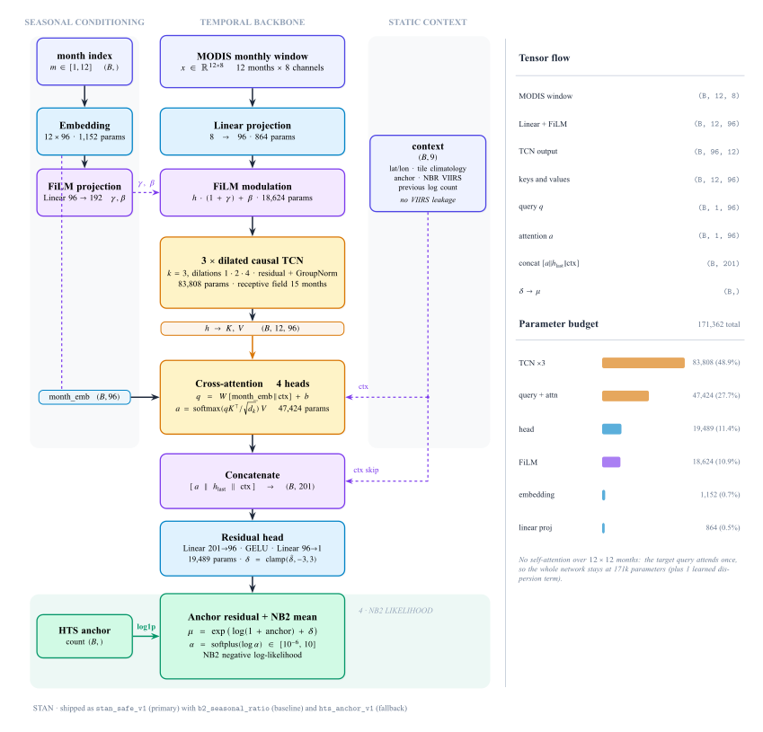

# STAN architecture (TorchView)

STAN = **S**patial-**T**emporal **A**nchor **N**etwork: a small negative-binomial
count model that predicts a **residual on the HTS anchor**, not the level.

- Model: `backend/app/firms/stan.py` (`class STAN`)
- Parameters: **171,362**
- Inputs: 12-month MODIS sequence `(B,12,8)`, static context `(B,9)`, month `(B,)`
- Outputs: `delta (B,)` and NB2 dispersion `alpha (scalar)`
- Mean: `mu = exp(log1p(anchor_count) + clamp(delta, -3, 3))`
- Loss: negative-binomial NB2 likelihood



- Clean layout (Graphviz source): [`stan_architecture.dot`](stan_architecture.dot)
- Full auto-generated TorchView graph: [`stan_torchview.dot`](stan_torchview.dot)
- PNG for slides: [`stan_architecture.png`](stan_architecture.png)

Regenerate the TorchView DOT:

```bash
pip install torchview graphviz
cd backend
python - <<'PY'
import torch
from torchview import draw_graph
from app.firms import stan
m = stan.STAN(len(stan.SEQ_FEATURES), len(stan.SAFE_CTX)); m.eval()
g = draw_graph(
    m,
    input_size=[(1, stan.WIN, len(stan.SEQ_FEATURES)),
                (1, len(stan.SAFE_CTX)), (1,)],
    dtypes=[torch.float32, torch.float32, torch.long],
    graph_name="STAN", depth=2, device="cpu",
)
open("../docs/stan_torchview.dot", "w").write(g.visual_graph.source)
PY
```

Render either DOT with Graphviz (`dot -Tsvg`). The committed SVG was rendered
with Graphviz 16 via `@viz-js/viz` (WASM), so no system binary is required.

## Shapes (TorchView trace, batch B)

| stage | module | output |
|---|---|---|
| input | sequence | `(B, 12, 8)` |
| input | context | `(B, 9)` |
| input | month index | `(B,)` |
| projection | `proj` Linear | `(B, 12, 96)` |
| season | `month` Embedding + `film` | `(B, 96)` → `(B, 192)` |
| TCN | `conv0/1/2` + residual + GroupNorm | `(B, 96, 12)` |
| attention | query `(B, 96)`, kv `(B, 12, 96)` | `(B, 1, 96)` |
| head input | concat | `(B, 201)` |
| head | `head` Sequential | `(B, 1)` |
| output | `delta` / `alpha` | `(B,)` / scalar |

## Why this shape

1. **Anchor-relative**: the head is zero-initialised, so training starts at the
   HTS anchor (`delta = 0`). The model can only move away from a sane baseline.
2. **Seasonality**: the month embedding drives FiLM (scale/shift) on every
   timestep; the causal dilated TCN sees 1/2/4-month receptive fields.
3. **Target query**: one learned query (month + context) cross-attends over the
   12-month window; no 12×12 self-attention, so parameters stay at 171k.
4. **Counts, not Gaussian**: NB2 dispersion is learned (`log_alpha`) and
   clamped; the likelihood handles zeros and overdispersion.
5. **No same-month neighbour VIIRS**: `SAFE_CTX` excludes it, so the served
   variant is forecast-safe. The retrospective twin (`stan_retro_raw.json`) is
   diagnostic only.

## Parameter budget

| block | params |
|---|---:|
| input projection | 864 |
| month embedding | 1,152 |
| FiLM | 18,624 |
| 3 × Conv1d (96→96, k=3) | 83,232 |
| 3 × GroupNorm | 576 |
| target query | 10,176 |
| attention | 37,248 |
| head | 19,489 |
| `log_alpha` | 1 |
| **total** | **171,362** |
