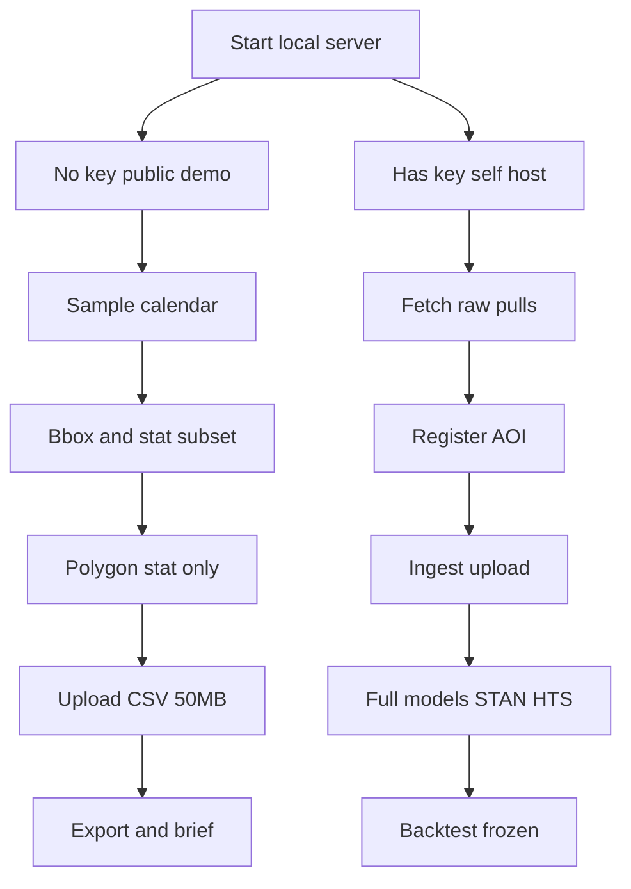

# Trial guide: reproduce without a NASA key, then go full AOI with one

Audience: a researcher with no `FIRMS_MAP_KEY`.
Goal: try the product today.
Later: re-run it on real pulls.
Units everywhere are hotspot detections / sensor-adjusted activity index.
These are never confirmed fires.
VIIRS is a sensor reference, not ground truth (see `docs/TRUTH_CONTRACT.md`).

Base URL below is `http://127.0.0.1:8000` (from `make demo` or `make dev`).
`ADMIN_TOKEN` note: upload/register/ingest endpoints are open in local dev.
They return `401`/`403`/`503` only when the server sets `ADMIN_TOKEN`.
Production always sets it.
If a write call is gated on a public host, stay on path B.

## Map: which path fits you



## Path B: no key (public demo)

### B1. Sample calendar (works with zero data on disk)

Do this: check the server answers with synthetic data.
Run this:

```bash
curl -s 'http://127.0.0.1:8000/api/firms/sample?aoi=vietnam&limit=5' | head -c 600
curl -s 'http://127.0.0.1:8000/api/firms/calendar?aoi=vietnam&data=sample&method=stat' | head -c 600
```

You see this: a JSON calendar object (truncated to 600 chars).
It is labelled `synthetic demo, NOT observed`.
Example shape (fields, values truncated):

```json
{
  "aoi": "vietnam",
  "data": "sample",
  "method": "stat",
  "months": ["YYYY-MM", "..."],
  "note": "synthetic demo, NOT observed"
}
```

If it fails: `400 Unknown aoi` means the `aoi=` value is wrong.
Sample only accepts preset AOIs (`vietnam`, `amazon`, `australia`).
Fix: use one of those three values.

### B2. Spatial and temporal subset (always `method=stat`)

Do this: filter the same sample by box, polygon, or date.
Run this:

```bash
# bbox subset (any dataset, stat path)
curl -s 'http://127.0.0.1:8000/api/firms/calendar?aoi=vietnam&data=sample&method=stat&bbox=104,10,109,16' | head -c 600

# custom polygon (URL-encoded GeoJSON Polygon/MultiPolygon), stat-only
curl -s --get 'http://127.0.0.1:8000/api/firms/calendar' \
  --data-urlencode 'aoi=vietnam' \
  --data-urlencode 'data=sample' \
  --data-urlencode 'method=stat' \
  --data-urlencode 'geometry={"type":"Polygon","coordinates":[[[104,10],[109,10],[109,16],[104,16],[104,10]]]}' | head -c 600

# date window, stat-only
curl -s 'http://127.0.0.1:8000/api/firms/calendar?aoi=vietnam&data=sample&method=stat&from_date=2024-01-01&to_date=2024-06-30' | head -c 600
```

You see this: the same calendar JSON shape as B1.
It covers only the requested box, polygon, or date window.

If it fails: subset with `method=hts` or `method=stan` returns `409`.
Codes are `model_requires_full_aoi` or `geometry_requires_stat_method`.
Reason: STAN/HTS are AOI-level monthly totals.
They cover the full AOI and full month.
They cannot be reallocated to a polygon.
Fix: retry the same subset with `method=stat`.

### B3. Your own CSV: session upload (no key, no persistence)

Do this: upload a FIRMS export, then read its calendar and brief.
Run this:

```bash
curl -s -X POST 'http://127.0.0.1:8000/api/firms/upload-dataset' \
  -F 'file=@my_firms_export.csv' | head -c 600
# → {"dataset_id":"upload:<hex>", "calendar_url":"/calendar?dataset=upload:<hex>", ...}

ID=upload:PASTE_HEX_HERE
curl -s "http://127.0.0.1:8000/api/firms/calendar?dataset=${ID}&method=stat" | head -c 600
curl -s "http://127.0.0.1:8000/api/firms/brief?dataset=${ID}&method=stat" | head -c 1200
```

You see this: first call returns a `dataset_id` shaped like `upload:<hex>`.
Second call returns calendar JSON for that id.
Third call returns a one-page Markdown brief.
The dataset is labelled `user-uploaded session dataset (unverified source)`.
It is not a manifest-backed pull.
Coverage and uncertainty report unknown.

If it fails: file over 50 MB returns `400` or `413`.
Empty file returns `400`.
Unknown `dataset=` returns `404`.
Fix: split the CSV, re-upload, and copy the full `dataset_id`.
Note: uploads accept `method=stat` only.
`hts` or `stan` on an upload returns `409` (no tiles for it).

### B4. Take something home: export and brief

Do this: save the B1 result as CSV and Markdown.
Run this:

```bash
curl -s 'http://127.0.0.1:8000/api/firms/export?aoi=vietnam&data=sample&method=stat' -o harmonized.csv
curl -s 'http://127.0.0.1:8000/api/firms/export-detections?aoi=vietnam&data=sample' -o detections.csv
curl -s 'http://127.0.0.1:8000/api/firms/brief?aoi=vietnam&data=sample&method=stat' -o brief.md
```

You see this: three files on disk.
`harmonized.csv` matches the `/calendar` path.
Check response headers `X-Filter-Hash` and `X-Row-Count`.
`brief.md` is the one-page Markdown for the same method and dataset.
Note: `brief` takes `bbox` but not `geometry`.

If it fails: apply the same fixes as B1 and B2.
Check `aoi=` spelling and keep `method=stat`.

## Path A: self-host with a key (full AOI, STAN/HTS)

Do this: fetch real monthly pulls with your NASA key.
Run this:

```bash
export FIRMS_MAP_KEY=<key>   # https://firms.modaps.eosdis.nasa.gov/api/area/
cd backend
../.venv/bin/python -m scripts.firms.fetch_full_month \
  --aoi vietnam --bbox 104,10,109,16 --start-year 2012 --end-year 2025 --workers 4
../.venv/bin/python -m scripts.firms.fetch_missing --aoi vietnam --start-year 2012 --end-year 2025
```

You see this: per-month raw files land on disk.
Missing months get backfilled by the second command.
Use `.venv/bin/python` (system `python3` lacks project deps).

Custom region: register first, then fetch or ingest into it.
Run this:

```bash
curl -s -X POST 'http://127.0.0.1:8000/api/firms/aois' \
  -H 'Content-Type: application/json' \
  -d '{"label":"My reserve","bbox":[104,10,109,16]}'
# → {"id":"my-reserve", ...} ; bad bbox → 400, duplicate id → 409

curl -s -X POST 'http://127.0.0.1:8000/api/firms/ingest?aoi=my-reserve&source=upload' \
  -F 'file=@my_firms_export.csv' | head -c 600
```

You see this: first call returns an id shaped like `my-reserve`.
Bad bbox returns `400`.
Duplicate id returns `409`.

If it fails: fix bbox order and range (`minLon,minLat,maxLon,maxLat`).
Pick a new id on `409`.

Then the served-model path (full AOI, full month, no filters).
Run this:

```bash
curl -s 'http://127.0.0.1:8000/api/firms/calendar?aoi=vietnam&data=raw&method=stan' | head -c 600
curl -s 'http://127.0.0.1:8000/api/firms/models' | head -c 900   # recommended_primary vs statistically_established
curl -s 'http://127.0.0.1:8000/api/firms/backtest?aoi=vietnam&data=raw&test_years=2' | head -c 600
```

You see this: a raw calendar built with the STAN model.
`/models` names `recommended_primary` and `statistically_established`.
`/backtest` returns the frozen evaluation table.

If it fails: `/backtest` never trains.
It reads the committed evaluation manifest.
`refresh=1` returns `409 refresh_requires_offline_pipeline`.
Rebuild offline with `python -m scripts.firms.retrain_all`, then restart.
A `test_years` value that disagrees with the manifest returns `409 evaluation_split_mismatch`.

## Error matrix: what to expect, and the exit

| Endpoint | dataset x method | Expected failure | Exit | Example command that triggers it |
|---|---|---|---|---|
| `calendar`, `export`, `brief` | `sample` + `hts`/`stan` | `409` (model needs raw tiles, sample has none) | use `method=stat` on sample | `curl -s 'http://127.0.0.1:8000/api/firms/calendar?aoi=vietnam&data=sample&method=stan'` |
| `calendar`, `export` | `raw` + `hts`/`stan` + `bbox`/`geometry`/`from_date`/`to_date` | `409 model_requires_full_aoi` / `geometry_requires_stat_method` | same subset with `method=stat`, or full AOI for the model | `curl -s 'http://127.0.0.1:8000/api/firms/calendar?aoi=vietnam&data=raw&method=stan&bbox=104,10,109,16'` |
| `calendar`, `export`, `brief` | `raw`, AOI with nothing fetched | `404 no_raw_data` | `data=sample`, or fetch first (path A) | `curl -s 'http://127.0.0.1:8000/api/firms/calendar?aoi=vietnam&data=raw&method=stat'` (before any fetch) |
| any | `sample`, unknown `aoi` | `400 Unknown aoi` | pick a preset, or register + use `raw` | `curl -s 'http://127.0.0.1:8000/api/firms/sample?aoi=atlantis&limit=5'` |
| `calendar` (+`export`) | `dataset=upload:<bad>` | `404` | re-upload, copy the full `dataset_id` | `curl -s 'http://127.0.0.1:8000/api/firms/calendar?dataset=upload:deadbeef&method=stat'` |
| `upload-dataset`, `ingest` | file over 50 MB / empty | `400`/`413` | split the CSV, or fetch server-side instead | `curl -s -X POST 'http://127.0.0.1:8000/api/firms/upload-dataset' -F 'file=@huge_export.csv'` |
| `aois` POST | bad bbox / duplicate id | `400` / `409` | fix order/range (`minLon,minLat,maxLon,maxLat`), pick a new id | `curl -s -X POST 'http://127.0.0.1:8000/api/firms/aois' -H 'Content-Type: application/json' -d '{"label":"My reserve","bbox":[104,10,109,16]}'` (repeat twice for `409`) |
| `backtest` | `refresh=1` / wrong `test_years` | `409` | read the frozen table, retrain offline only | `curl -s 'http://127.0.0.1:8000/api/firms/backtest?aoi=vietnam&data=raw&test_years=2&refresh=1'` |

General rule: `400` means bad input (fix the request).
`404` means no such data or dataset on this server (switch feed or fetch).
`409` means truth guard (take the labelled path the message names).

## State, links, and what does not travel

- The dashboard AOI, feed, method, and filters live in the URL (example: `/calendar?aoi=vietnam&data=raw...`).
- Copy that URL as the share link. That URL is the experiment record.
- An unsaved bbox or polygon in the browser is client-side state.
- It is lost when you switch machines.
- Keep it by copying the share link (with `?aoi=...` plus filter query).
- Or register the region server-side (`POST /api/firms/aois`).
- Then it becomes a first-class `aoi=` anyone can query.
- Session uploads (`upload:<hex>`) live on the server that received them.
- They expire with it. They are not portable.
- For a durable custom region, use path A (register plus fetch/ingest).

## Checklist: 5 minutes, done means you can work alone

- [ ] B1 returns calendar JSON labelled `synthetic demo, NOT observed` for `aoi=vietnam`.
- [ ] B2 returns a smaller calendar JSON when `bbox=104,10,109,16` is added with `method=stat`.
- [ ] B4 writes `harmonized.csv`, `detections.csv`, and `brief.md` to disk (check with `ls -l`).
- [ ] Error path is confirmed: `aoi=atlantis` on sample returns `400 Unknown aoi`.
- [ ] Share link is saved: a `/calendar?aoi=vietnam...` URL that reproduces your view on a fresh browser tab.
